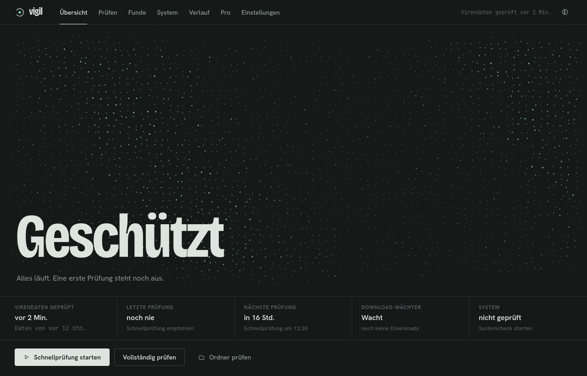
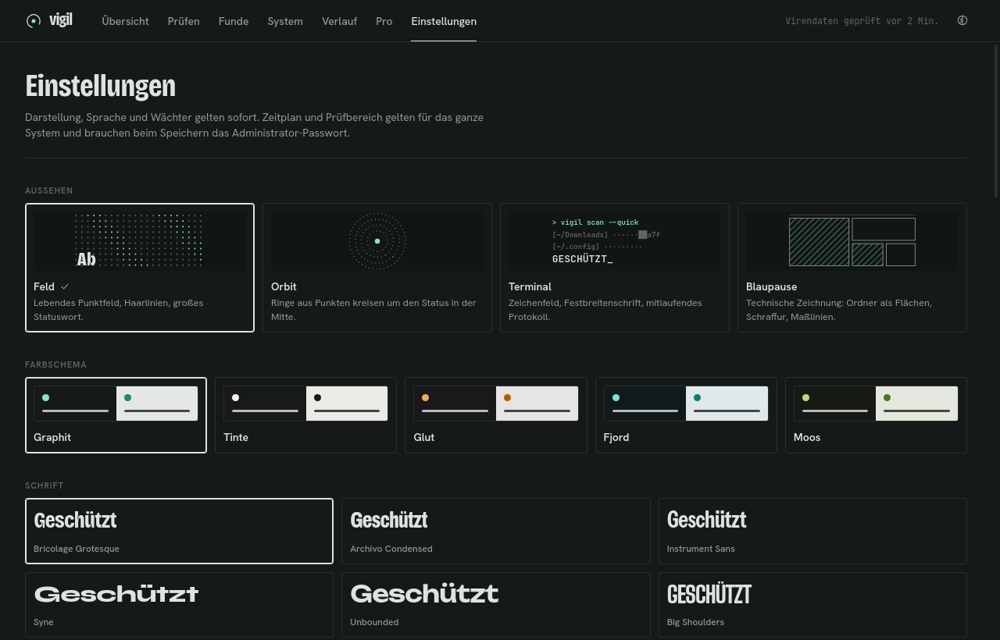
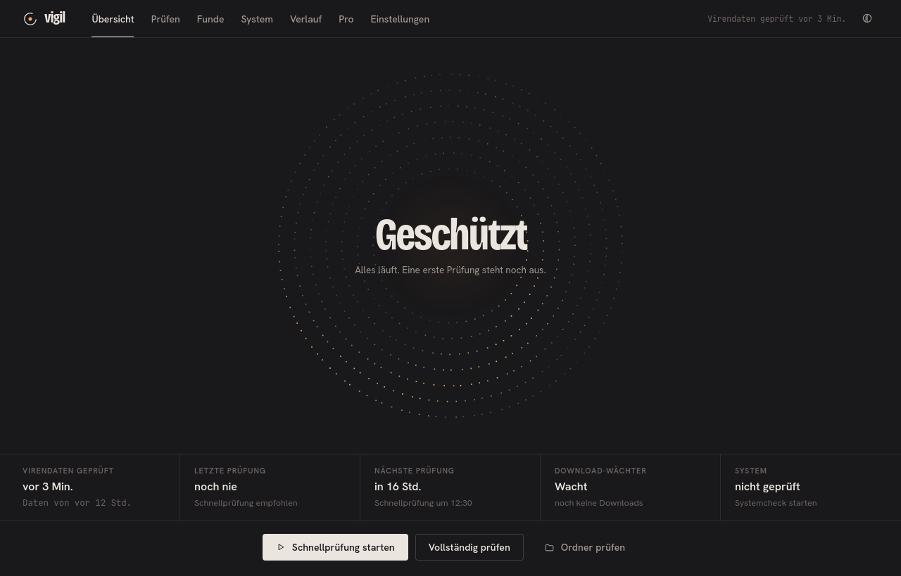
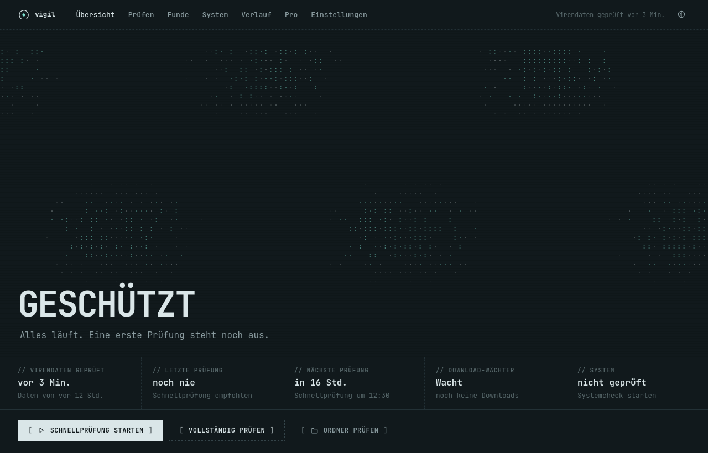
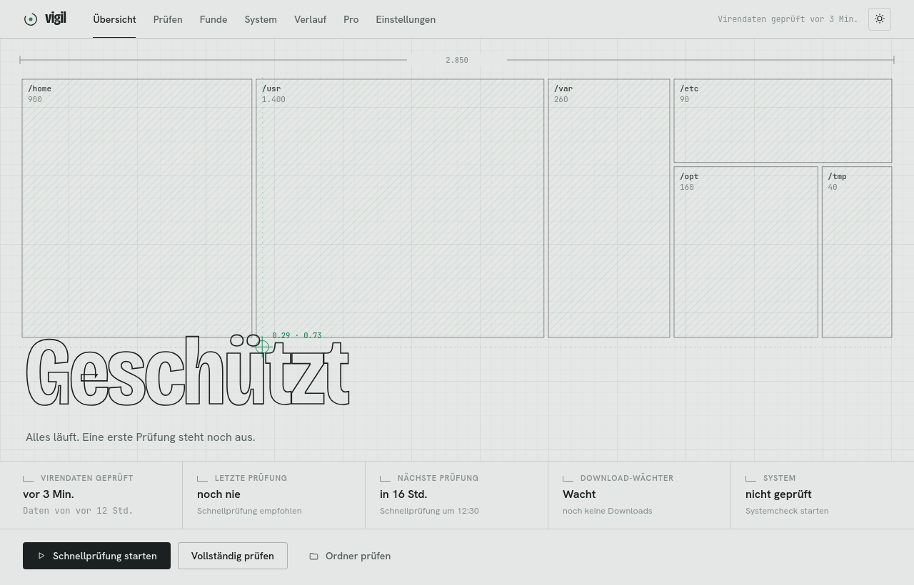
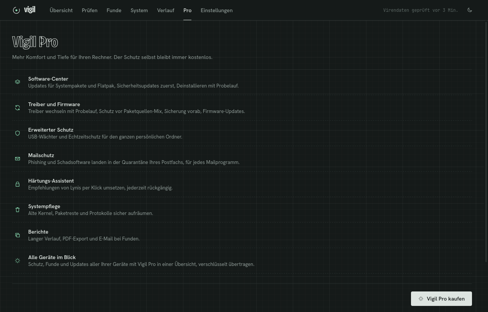

<p align="center">
  
</p>

<h1 align="center">Vigil</h1>

<p align="center">
  Virenschutz für Linux und Windows, mit ClamAV, freundlich und ruhig.<br>
  <b>Deutsch</b> · <a href="#english">English</a>
</p>

<p align="center">
  <a href="https://github.com/noosmedia/vigil/releases/latest"></a>
  <a href="LICENSE"></a>
  
</p>



## Was Vigil macht

- **Prüft nach Zeitplan** mit ClamAV: Schnellprüfung der Orte, an denen Schadsoftware meist landet (Downloads, Desktop, Autostart, Temp), vollständige Prüfung aller Laufwerke oder einzelne Ordner. Pausieren und Abbrechen jederzeit.
- **Download-Wächter**: Neue Dateien im Download-Ordner werden sofort geprüft, mit Benachrichtigung bei einem Fund.
- **Quarantäne**: Funde werden eingeschlossen und lassen sich wiederherstellen, freigeben oder endgültig löschen.
- **Systemcheck**: Unter Linux Updates, Firewall, offene Ports, Rootkits (rkhunter) und Härtung (Lynis); unter Windows Windows Update, Microsoft Defender, Firewall, BitLocker und offene Ports. Mit verständlichen Erklärungen und Lösungen per Klick.
- **Updates** für Vigil selbst, jede Version mit Ed25519 signiert und vor der Installation geprüft.
- **Vier Looks, fünf Farbschemata, hell und dunkel**, Deutsch und Englisch. Läuft im Tray mit Live-Menü.

| | |
|---|---|
|  |  |
|  |  |

## Installation

Die Dateien der neuesten Version gibt es auf der [Release-Seite](https://github.com/noosmedia/vigil/releases/latest).

**Linux Mint, Ubuntu, Debian** (64 Bit):

```bash
sudo apt install --no-install-recommends ./Vigil_<version>_amd64.deb
```

Das Paket bringt ClamAV, rkhunter und Lynis mit. `--no-install-recommends` verhindert, dass rkhunter einen Mailserver nachinstalliert. Vigil startet danach bei jeder Anmeldung im Tray.

**Windows 10 und 11** (64 Bit): `Vigil_<version>_x64-setup.exe` starten. Der Installer richtet den Vigil-Dienst ein und bringt ClamAV mit. Vigil arbeitet neben Microsoft Defender. Der Installer ist nicht mit einem Zertifikat signiert, deshalb fragt Windows SmartScreen beim ersten Start nach („Weitere Informationen“, dann „Trotzdem ausführen“).

Weitere Updates installiert Vigil selbst.

## Kostenlos und frei

Vigil ist freie Software unter der [GPL-3.0-or-later](LICENSE). Der Schutz ist und bleibt kostenlos.

Wer mehr möchte, kann **Vigil Pro** als optionalen Zusatz abonnieren: Software- und Treiber-Updates, USB-Wächter, erweiterter Echtzeitschutz, Mailschutz, Härtungs-Assistent, Systempflege, Berichte und eine Übersicht aller eigenen Geräte. Vigil Pro ist nicht Teil dieses Repositorys und wird nach dem Kauf direkt in Vigil freigeschaltet.



## Selbst bauen

Voraussetzungen: Rust, Node.js mit npm, webkit2gtk-4.1 und libayatana-appindicator3 (jeweils mit Entwicklerpaketen).

```bash
npm install
npm run tauri build
```

Das Ergebnis liegt unter `target/release/bundle/deb/`. Den Windows-Installer baut man von Linux aus mit mingw-w64, NSIS und dem Rust-Ziel `x86_64-pc-windows-gnu`:

```bash
rustup target add x86_64-pc-windows-gnu
npm run tauri build -- --target x86_64-pc-windows-gnu
```

Entwicklung: `npm run tauri dev`. Ohne installierten Helfer zeigt die App den Einrichtungsbildschirm. Für Tests ohne Administratorrechte setzt `VIGIL_DEV=1` zusammen mit `VIGIL_DATA_DIR`, `VIGIL_CONFIG_DIR` und `VIGIL_HELPER_DIR` eigene Ordner ein.

### Aufbau

| Ordner | Inhalt |
|---|---|
| `src/` | Oberfläche (Svelte 5, TypeScript) |
| `src-tauri/` | Desktop-App mit Tray, Download-Wächter und Updates (Tauri 2) |
| `crates/vigil-core/` | Scanner, Quarantäne, Systemcheck, Zeitplan, Datenformate |
| `crates/vigil-helper/` | Helfer mit Administratorrechten: unter Linux über pkexec und systemd-Timer, unter Windows als Vigil-Dienst und über die Benutzerkontensteuerung |
| `packaging/` | polkit-Regel, systemd-Units, Paketskripte, Windows-Installer |
| `docs/WINDOWS.md` | Einzelheiten zur Windows-Fassung |

Änderungen stehen im [CHANGELOG](CHANGELOG.md).

---

<a id="english"></a>

## English

Antivirus for Linux and Windows, built on ClamAV, friendly and calm.

### What Vigil does

- **Scheduled scans** with ClamAV: a quick scan of the places where malware usually lands (downloads, desktop, autostart, temp), a full scan of all drives or single folders. Pause and cancel at any time.
- **Download watcher**: new files in the download folder are scanned immediately, with a notification on a finding.
- **Quarantine**: findings are locked away and can be restored, allowed or deleted for good.
- **System check**: on Linux updates, firewall, open ports, rootkits (rkhunter) and hardening (Lynis); on Windows Windows Update, Microsoft Defender, firewall, BitLocker and open ports. With plain explanations and one-click fixes.
- **Updates** for Vigil itself, every version signed with Ed25519 and verified before installing.
- **Four looks, five colour schemes, light and dark**, German and English. Lives in the tray with a live menu.

### Installation

Get the files of the latest version from the [releases page](https://github.com/noosmedia/vigil/releases/latest).

**Linux Mint, Ubuntu, Debian** (64-bit):

```bash
sudo apt install --no-install-recommends ./Vigil_<version>_amd64.deb
```

The package brings ClamAV, rkhunter and Lynis. `--no-install-recommends` keeps rkhunter from pulling in a mail server. Vigil then starts in the tray at every login.

**Windows 10 and 11** (64-bit): run `Vigil_<version>_x64-setup.exe`. The installer sets up the Vigil service and brings ClamAV. Vigil works alongside Microsoft Defender. The installer is not signed with a certificate, so Windows SmartScreen asks on first launch ("More info", then "Run anyway").

Vigil installs further updates by itself.

### Free and open

Vigil is free software under the [GPL-3.0-or-later](LICENSE). Protection is and stays free.

For more, **Vigil Pro** is an optional subscription: software and driver updates, USB guard, extended real-time protection, mail protection, hardening assistant, system cleanup, reports and an overview of all your devices. Vigil Pro is not part of this repository and is activated directly in Vigil after purchase.

### Building

Requirements: Rust, Node.js with npm, webkit2gtk-4.1 and libayatana-appindicator3 (with development packages).

```bash
npm install
npm run tauri build
```

The result is in `target/release/bundle/deb/`. The Windows installer is built from Linux with mingw-w64, NSIS and the Rust target `x86_64-pc-windows-gnu`:

```bash
rustup target add x86_64-pc-windows-gnu
npm run tauri build -- --target x86_64-pc-windows-gnu
```

Development: `npm run tauri dev`. Without the installed helper the app shows the setup screen. For tests without administrator rights, `VIGIL_DEV=1` together with `VIGIL_DATA_DIR`, `VIGIL_CONFIG_DIR` and `VIGIL_HELPER_DIR` uses separate folders.

Changes are listed in the [CHANGELOG](CHANGELOG.md).
